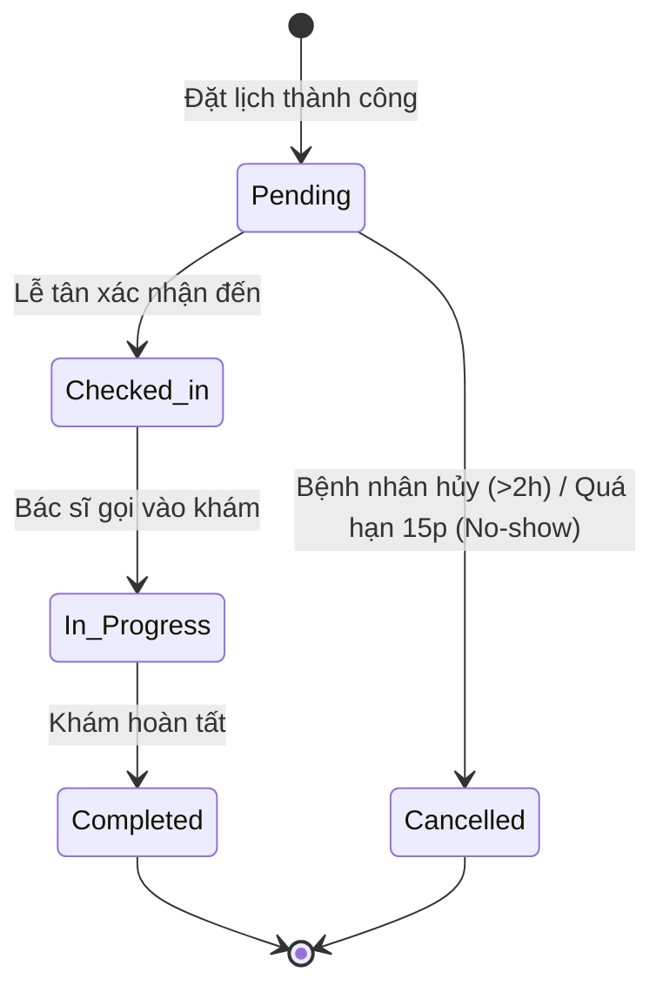

# Smart Clinic — Hệ Thống Quản Lý & Đặt Lịch Khám Bệnh Thông Minh

> **Đồ án phát triển phần mềm**  
> **Sinh viên thực hiện:** Nguyễn Văn Mạnh  
> **Tech Stack chính:** PHP 8.3+ | Laravel | MySQL | Tailwind CSS | Alpine.js | AI Symptom Extraction  

---

## 1. Giới thiệu tổng quan (Overview)

**Smart Clinic** là nền tảng quản lý phòng khám và hỗ trợ đặt lịch khám bệnh trực tuyến được thiết kế theo hướng hiện đại, thân thiện và thông minh. Dự án tập trung giải quyết bài toán giảm thiểu thời gian chờ đợi của bệnh nhân, chuẩn hóa quy trình phân luồng người bệnh và hỗ trợ người dùng lựa chọn đúng chuyên khoa khám thông qua trợ lý AI trích xuất triệu chứng tự động.

### Mục tiêu cốt lõi:
- **Tối ưu quy trình đặt lịch:** Bệnh nhân chủ động chọn cơ sở, chuyên khoa, bác sĩ và khung giờ khám còn trống.
- **Hỗ trợ định hướng bằng AI (AI Symptom Extraction):** Phân tích mô tả triệu chứng ngôn ngữ tự nhiên của người bệnh để gợi ý chuyên khoa khám phù hợp dựa trên tập luật (Rule-based recommendation).
- **Phân quyền và bảo mật chặt chẽ:** Quy định rõ quyền hạn và ranh giới dữ liệu cho 4 nhóm đối tượng: Bệnh nhân, Lễ tân, Bác sĩ và Quản trị viên.
- **Kiểm soát tính toàn vẹn nghiệp vụ:** Chống đặt trùng khung giờ (race condition), kiểm soát hủy/đổi lịch hợp lệ, quản lý vắng mặt (no-show) tự động.

---

## 2. Kiến trúc công nghệ (Tech Stack)

| Thành phần | Công nghệ sử dụng | Ghi chú |
|---|---|---|
| **Backend Framework** | Laravel 11 / 13 | PHP 8.3+, kiến trúc MVC chuẩn, Eloquent ORM, Service Layer |
| **Authentication** | Laravel Breeze | Quản lý đăng nhập, đăng ký, xác thực phiên bảo mật |
| **Frontend UI** | Blade + Tailwind CSS v4 + Alpine.js | Giao diện Responsive hiện đại, tương tác động mượt mà |
| **Build Tool** | Vite | Biên dịch tài nguyên CSS/JS tốc độ cao |
| **Cơ sở dữ liệu** | MySQL 8.x | Đảm bảo tính nhất quán qua Foreign Keys và Transactions |
| **Trí tuệ nhân tạo (AI)** | LLM Prompting & Rule Matcher | Trích xuất triệu chứng từ văn bản tự do và ánh xạ bộ quy tắc chuyên khoa |

---

## 3. Các vai trò người dùng (Roles & Permissions)

Hệ thống thiết kế phân quyền nghiêm ngặt theo mô hình **RBAC (Role-Based Access Control)** với 4 vai trò chính:

```
                  ┌──────────────────────┐
                  │ Quản trị viên (Admin) │
                  └──────────┬───────────┘
                             │
     ┌───────────────────────┼───────────────────────┐
     │                       │                       │
┌────┴────────────┐  ┌───────┴────────┐  ┌───────────┴──────────┐
│ Bệnh nhân       │  │ Lễ tân         │  │ Bác sĩ               │
│ (Patient)       │  │ (Receptionist) │  │ (Doctor)             │
└─────────────────┘  └────────────────┘  └──────────────────────┘
```

### Chi tiết quyền hạn:
1. **Bệnh nhân (Patient):**
   - Đăng ký, đăng nhập và quản lý hồ sơ cá nhân (bắt buộc hoàn thiện CCCD, Ngày sinh, Số điện thoại trước khi đặt lịch).
   - Tra cứu chuyên khoa, thông tin bác sĩ và khung giờ còn trống.
   - Nhập triệu chứng ngôn ngữ tự nhiên -> Nhận gợi ý chuyên khoa từ AI (tùy chọn).
   - Đặt lịch khám bệnh cho chính mình và nhận phiếu hẹn điện tử.
   - Hủy lịch hoặc đổi lịch khám (yêu cầu trước giờ khám tối thiểu 2 giờ).
   - Tra cứu lịch sử khám bệnh và phiếu hẹn đã đăng ký.

2. **Lễ tân (Receptionist):**
   - Tra cứu danh sách bệnh nhân và lịch hẹn trong ngày theo khung giờ/phòng khám.
   - Tiếp đón bệnh nhân: Kiểm tra thông tin CCCD/Mã hẹn và chuyển trạng thái sang `Checked-in`.
   - Đánh dấu vắng mặt (`Cancelled - No Show`) khi bệnh nhân trễ hẹn quá 15 phút so với giờ bắt đầu.
   - Theo dõi và hỗ trợ bệnh nhân trong các tình huống ngoại lệ (Bác sĩ nghỉ đột xuất).

3. **Bác sĩ (Doctor):**
   - Xem danh sách hàng đợi bệnh nhân được phân công trong ca làm việc.
   - Xem chi tiết triệu chứng bệnh nhân đã khai báo sau khi đã tiếp nhận.
   - Cập nhật tiến trình khám bệnh: `Checked-in` ➔ `In Progress` ➔ `Completed`.
   - Lưu trữ kết quả và chỉ định chuyên môn cho lượt khám.

4. **Quản trị viên (Admin):**
   - Quản trị tài khoản người dùng, phân vai trò.
   - Quản lý danh mục cơ sở y tế (Clinics), chuyên khoa (Specialties), phòng khám, danh mục triệu chứng (Symptoms).
   - Quản lý lịch làm việc của bác sĩ: Cấu hình ca trực, khung giờ khám (Slots), ngày nghỉ/ca nghỉ đột xuất.
   - Xem báo cáo thống kê lượt khám và nhật ký kiểm toán hệ thống (`audit_logs`).

---

## 4. Quy trình nghiệp vụ cốt lõi (Core Business Workflows)

### 4.1. Vòng đời trạng thái lịch hẹn (Appointment Lifecycle)
Mỗi lịch hẹn tuân theo quy trình chuyển trạng thái 1 chiều nghiêm ngặt:



- **Quy tắc chặn sai quy trình (Validation):**
  - Không thể nhảy cóc từ `Pending` thẳng sang `In Progress` hoặc `Completed` mà chưa qua bước lễ tân tiếp nhận.
  - Lịch đã `Checked-in`, `In Progress` hoặc `Completed` tuyệt đối không thể bị hủy (`Cancelled`).
  - Lịch `Completed` không thể đảo ngược trạng thái.

---

### 4.2. Luồng Đặt lịch & Hỗ trợ AI (Booking Flow)
1. **Kiểm tra điều kiện tiên quyết:** Bệnh nhân phải đăng nhập và đã cập nhật số CCCD/Định danh cá nhân.
2. **Khai báo triệu chứng (Tùy chọn):**
   - Bệnh nhân nhập mô tả triệu chứng tự do (ví dụ: *"Tôi bị đau họng 2 ngày nay, nuốt đau và sốt nhẹ"*).
   - Trợ lý AI phân tích và trích xuất danh sách triệu chứng chuẩn (Đau họng, Sốt nhẹ).
   - Hệ thống so khớp bộ quy tắc để đề xuất chuyên khoa ưu tiên (ví dụ: *Tai Mũi Họng*).
   - Bệnh nhân có thể chấp nhận gợi ý hoặc tự chọn chuyên khoa khác theo nguyện vọng.
3. **Lựa chọn khung giờ:** Bệnh nhân chọn Bác sĩ, Ngày khám và Khung giờ còn trống (`Appointment Slot`).
4. **Xác nhận giao dịch (Transaction):**
   - Hệ thống khóa giữ chỗ và kiểm tra tính hợp lệ tại máy chủ (chống đặt trùng bởi 2 người cùng lúc).
   - Tạo mã phiếu hẹn duy nhất, ghi nhận trạng thái ban đầu là `Pending`.

---

### 4.3. Quy tắc Hủy và Đổi lịch (Cancellation & Rescheduling)
- **Hủy lịch:** Chỉ được hủy khi còn **ít nhất 2 giờ** trước giờ khám bắt đầu. Hủy thành công sẽ tự động giải phóng khung giờ cho bệnh nhân khác.
- **Đổi lịch:** Chỉ được đổi khi còn **ít nhất 2 giờ**, chuyển sang một khung giờ mới còn trống thuộc cùng chuyên khoa. Thao tác thực hiện qua Database Transaction để bảo toàn lịch cũ nếu đổi thất bại.

---

## 5. Thiết kế Cơ sở dữ liệu (Database Schema)

Hệ thống được thiết kế theo 2 giai đoạn:

### 5.1. Mô hình 8 bảng cốt lõi (Core Implementation)
Hiện tại, dự án đã triển khai đầy đủ Migration và Eloquent Models cho 8 bảng nền tảng:

1. **`roles`**: Danh mục vai trò (`Patient`, `Receptionist`, `Doctor`, `Admin`).
2. **`users`**: Tài khoản người dùng (tích hợp trường `cccd`, `phone`, `dob`, liên kết `role_id`).
3. **`clinics`**: Thông tin cơ sở y tế / phòng khám (Tên cơ sở, địa chỉ).
4. **`specialties`**: Danh mục chuyên khoa y tế (Nội tổng quát, Tai Mũi Họng, Da liễu, Cơ xương khớp,...).
5. **`doctors`**: Hồ sơ bác sĩ (liên kết `user_id`, `specialty_id`, `clinic_id`).
6. **`symptoms`**: Danh mục triệu chứng chuẩn dùng cho AI mapping (liên kết `specialty_id`).
7. **`schedules`**: Ca làm việc của bác sĩ theo ngày (`work_date`, `start_time`, `end_time`, `is_day_off`).
8. **`appointments`**: Lịch hẹn của bệnh nhân (`patient_id`, `doctor_id`, `schedule_id`, ngày hẹn, giờ khám, `status`, `ai_symptoms`).

### 5.2. Thiết kế ERD mở rộng (Target Architecture - 24 bảng)
Tài liệu thiết kế chi tiết tại [docs/erd.md](docs/erd.md) định hướng mở rộng toàn diện bao gồm:
- **Quản lý giữ chỗ & khung giờ mịn:** `WORK_SHIFTS`, `APPOINTMENT_SLOTS`, `SLOT_RESERVATIONS`, `DOCTOR_LEAVES`.
- **Triệu chứng & AI Logging:** `SYMPTOM_FORMS`, `AI_CONFIG_VERSIONS`, `AI_EXTRACTION_RUNS`, `FORM_SYMPTOMS`.
- **Tập luật gợi ý chuyên khoa:** `RULE_SETS`, `RECOMMENDATION_RULES`, `RULE_CONDITIONS`, `RECOMMENDATION_RUNS`, `RECOMMENDATION_RESULTS`.
- **Nhật ký & Tiếp đón:** `APPOINTMENT_EVENTS`, `CHECK_INS`, `AUDIT_LOGS`.

---

## 6. Cấu trúc thư mục dự án (Project Directory Structure)

```plaintext
Smart-Clinic/
├── app/
│   ├── Http/
│   │   └── Controllers/         # Bộ điều khiển xử lý nghiệp vụ (Auth, Profile,...)
│   └── Models/                  # 8 Eloquent Models cốt lõi (User, Doctor, Appointment,...)
├── config/                      # Cấu hình hệ thống Laravel
├── database/
│   ├── factories/               # Model factories phục vụ sinh dữ liệu test
│   ├── migrations/              # Lược đồ tạo bảng cơ sở dữ liệu
│   └── seeders/                 # Dữ liệu khởi tạo ban đầu (Master Data)
├── docs/                        # Tài liệu đặc tả kỹ thuật chi tiết
│   ├── appointment-rules.md     # Quy tắc đặt, hủy, đổi lịch khám (SC03)
│   ├── appointment-statuses.md  # Đặc tả vòng đời trạng thái & xử lý vắng mặt (SC04)
│   ├── data-dictionary.md       # Từ điển dữ liệu chi tiết các bảng (SC08)
│   ├── erd.md                   # Thuyết minh sơ đồ ERD mở rộng (SC05)
│   ├── mock-categories.md       # Dữ liệu danh mục mô phỏng (SC06)
│   ├── permissions.md           # Ma trận phân quyền RBAC (SC02)
│   └── use-cases.md             # Danh sách Use Case & Quy trình nghiệp vụ (SC07)
├── public/                      # Thư mục web gốc chứa index.php và assets
├── resources/
│   ├── css/                     # Tailwind CSS styles
│   ├── js/                      # Script JS frontend (Alpine.js)
│   └── views/                   # Giao diện Blade Templates
├── routes/
│   ├── auth.php                 # Tuyến đường đăng nhập/đăng ký
│   └── web.php                  # Tuyến đường ứng dụng web
├── tests/                       # Unit & Feature Test cases
├── composer.json                # Quản lý phụ thuộc PHP
├── package.json                 # Quản lý phụ thuộc Node.js & Vite
├── README.md                    # Tài liệu tổng quan dự án
└── TASKS.md                     # Bảng nhiệm vụ chi tiết theo từng giai đoạn (T1.1 -> T5.3)
```

---

## 7. Dữ liệu danh mục mô phỏng (Demo Master Data)

Hệ thống được thiết kế với bộ dữ liệu danh mục ban đầu phục vụ kiểm thử và demo:
- **1 Cơ sở khám:** Smart Clinic Vinh (Thành phố Vinh, Nghệ An).
- **4 Chuyên khoa chính:**
  1. *Nội tổng quát*
  2. *Tai Mũi Họng*
  3. *Da liễu*
  4. *Cơ xương khớp*
- **5 Bác sĩ phụ trách:** Phân bổ đều cho các chuyên khoa.
- **15 Triệu chứng chuẩn:** Dùng làm ground-truth để kiểm thử độ chính xác của AI trích xuất và ánh xạ chuyên khoa.

---

## 8. Hướng dẫn cài đặt và Khởi chạy (Getting Started)

### Yêu cầu hệ thống:
- PHP >= 8.3 (với các extensions: `pdo_mysql`, `mbstring`, `openssl`, `bcmath`, `curl`)
- Composer >= 2.x
- Node.js >= 18.x & NPM
- MySQL Server >= 8.0 (hoặc MariaDB tương đương qua Laragon / XAMPP)

### Các bước cài đặt:

1. **Di chuyển vào thư mục dự án:**
   ```bash
   cd d:/laragon/www/DA/Smart-Clinic
   ```

2. **Cài đặt các gói phụ thuộc PHP & JavaScript:**
   ```bash
   composer install
   npm install
   ```

3. **Cấu hình biến môi trường (`.env`):**
   ```bash
   cp .env.example .env
   php artisan key:generate
   ```
   *Kiểm tra thông số kết nối Database trong file `.env`:*
   ```env
   DB_CONNECTION=mysql
   DB_HOST=127.0.0.1
   DB_PORT=3306
   DB_DATABASE=smart_clinic
   DB_USERNAME=root
   DB_PASSWORD=
   ```

4. **Chạy Migration để tạo cấu trúc cơ sở dữ liệu:**
   ```bash
   php artisan migrate
   ```

5. **Biên dịch Assets và Khởi chạy máy chủ phát triển:**
   - Chạy đồng thời Vite và Laravel Server:
     ```bash
     npm run dev
     php artisan serve
     ```
   - Truy cập hệ thống tại: `http://127.0.0.1:8000`

---

## 9. Lộ trình phát triển (Milestones & Roadmap)

> 📌 Xem bảng phân rã nhiệm vụ chi tiết theo mã công việc (`T1.1` ➔ `T5.3`) tại **[TASKS.md](TASKS.md)**.

- [x] **Giai đoạn 1 (Thiết kế & Kiến trúc):**
  - Hoàn thiện tài liệu nghiệp vụ (Use cases, Quy tắc lịch hẹn, Phân quyền, Từ điển dữ liệu).
  - Hoàn thiện bản thiết kế tổng thể ERD 24 bảng.
  - Khởi tạo khung dự án Laravel, Breeze Auth và Tailwind CSS.
  - Xây dựng 8 Migration và Eloquent Models cốt lõi.
- [ ] **Giai đoạn 2 (Xây dựng chức năng cốt lõi):**
  - Seed dữ liệu danh mục mô phỏng (Clinics, Specialties, Doctors, Symptoms).
  - Giao diện và API Đặt lịch khám (Booking Flow) với kiểm tra ràng buộc chống race condition.
  - Tích hợp dịch vụ AI trích xuất triệu chứng và gợi ý chuyên khoa.
- [ ] **Giai đoạn 3 (Phân hệ Nghiệp vụ chuyên môn):**
  - Giao diện Tiếp đón & Check-in dành cho Lễ tân.
  - Giao diện Quản lý hàng đợi & Khám bệnh dành cho Bác sĩ.
  - Bảng điều khiển quản trị (Admin Dashboard) cấu hình ca trực và khung giờ khám.
- [ ] **Giai đoạn 4 (Kiểm thử & Tối ưu hóa):**
  - Viết Feature Test cho các kịch bản hủy/đổi lịch và bảo vệ phân quyền (Authorization Tests).
  - Tối ưu hóa truy vấn cơ sở dữ liệu và hoàn thiện tài liệu nghiệm thu đồ án.
