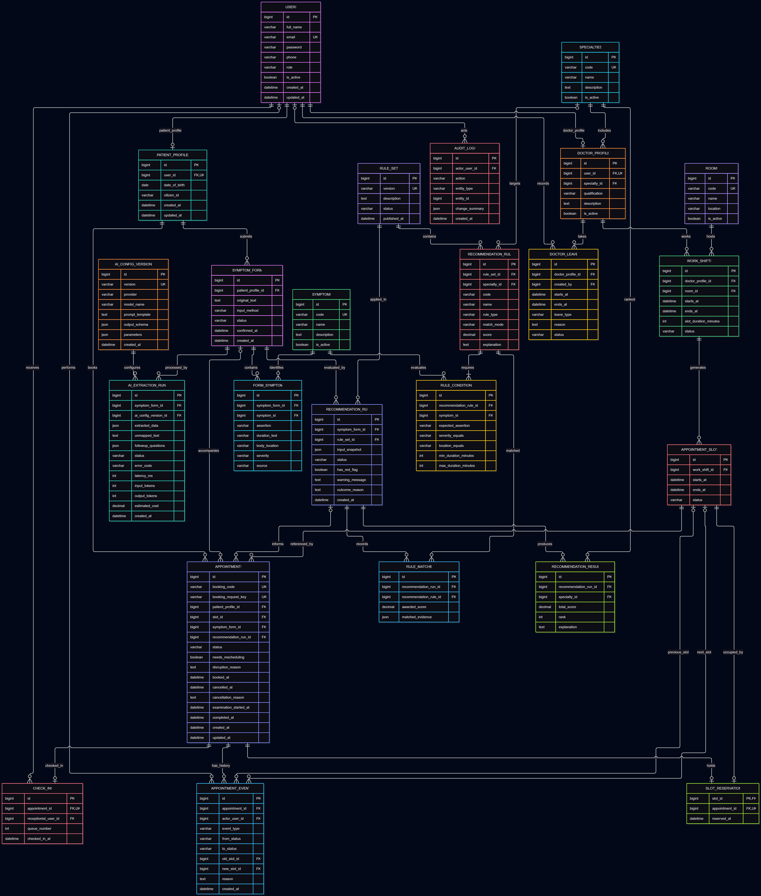

# SC05 — Sơ đồ ERD Smart Clinic

## Trạng thái

Bản nháp thiết kế tổng thể gồm 24 bảng.
Chưa phải cấu trúc cơ sở dữ liệu đã triển khai hoặc nghiệm thu.

## Mục tiêu

Mô tả các bảng dữ liệu, khóa chính, khóa ngoại và quan hệ
để phục vụ thiết kế cơ sở dữ liệu MySQL cho Smart Clinic.

## Tài liệu đầu vào

- [README](../README.md)
- [Đặc tả phân quyền](permissions.md)
- [Quy tắc đặt lịch](appointment-rules.md)
- Kế hoạch đồ án Smart Clinic do Nguyễn Văn Mạnh cung cấp.

## Sơ đồ

## Các nhóm dữ liệu

| Nhóm | Các bảng |
|---|---|
| Tài khoản và danh mục | USERS, PATIENT_PROFILES, DOCTOR_PROFILES, SPECIALTIES, ROOMS |
| Lịch làm việc | WORK_SHIFTS, APPOINTMENT_SLOTS, DOCTOR_LEAVES |
| Lịch hẹn và tiếp đón | APPOINTMENTS, SLOT_RESERVATIONS, APPOINTMENT_EVENTS, CHECK_INS |
| Triệu chứng và AI | SYMPTOMS, SYMPTOM_FORMS, AI_CONFIG_VERSIONS, AI_EXTRACTION_RUNS, FORM_SYMPTOMS |
| Gợi ý chuyên khoa | RULE_SETS, RECOMMENDATION_RULES, RULE_CONDITIONS, RECOMMENDATION_RUNS, RECOMMENDATION_RESULTS, RULE_MATCHES |
| Nhật ký | AUDIT_LOGS |

## Ký hiệu

- PK: khóa chính.
- FK: khóa ngoại.
- UK: ràng buộc duy nhất.
- ||: đúng một.
- o|: không hoặc một.
- o{: không hoặc nhiều.
- |{: một hoặc nhiều.

## Các quan hệ chính

- Một tài khoản có tối đa một hồ sơ bệnh nhân
  và tối đa một hồ sơ bác sĩ; loại hồ sơ phải phù hợp vai trò.
- Một chuyên khoa có nhiều bác sĩ.
- Một bác sĩ có nhiều ca làm việc.
- Một phòng được sử dụng trong nhiều ca không chồng thời gian.
- Một ca làm việc có nhiều khung giờ khám.
- Một bệnh nhân có nhiều lịch hẹn.
- Một khung giờ có thể được nhiều lịch hẹn tham chiếu trong lịch sử,
  nhưng chỉ có tối đa một bản ghi giữ chỗ.
- Một lịch hẹn có nhiều sự kiện lịch sử và tối đa một lần check-in.
- Một phiếu khai báo có nhiều triệu chứng và nhiều lần xử lý AI.
- Một bộ quy tắc có nhiều quy tắc; mỗi quy tắc có các điều kiện.
- Một lượt gợi ý lưu phiên bản quy tắc, kết quả theo chuyên khoa
  và các quy tắc đã khớp.

## Giả định thiết kế cần xác nhận

- Mỗi tài khoản có một vai trò.
- Mỗi bác sĩ thuộc một chuyên khoa.
- Bệnh nhân đặt lịch cho chính mình.
- Một khung giờ phục vụ một lịch hẹn còn giữ chỗ.
- AI là chức năng hỗ trợ, không bắt buộc để đặt lịch.
- Dữ liệu triệu chứng phải được xác nhận trước khi gợi ý chính thức.

## Ràng buộc nghiệp vụ cần triển khai

- Đủ họ tên, ngày sinh, số điện thoại và CCCD trước khi đặt lịch.
- Không chồng thời gian khám của cùng bệnh nhân.
- Không trùng ca bác sĩ hoặc phòng.
- Không đặt vào thời gian nghỉ hoặc khung giờ bị chặn.
- Chống tạo lịch trùng khi gửi lặp yêu cầu.
- Đặt, hủy và đổi lịch phải xử lý giao dịch phù hợp.
- Đổi lịch thất bại phải giữ nguyên lịch cũ.
- Kiểm tra thời hạn hủy/đổi và ngoại lệ nghỉ đột xuất
  theo tài liệu quy tắc đặt lịch.
- Kiểm tra quyền phía máy chủ.
- Phiếu triệu chứng phải thuộc đúng bệnh nhân của lịch hẹn.
- Lượt gợi ý phải thuộc đúng phiếu được sử dụng.
- Bản ghi giữ chỗ phải khớp khung giờ hiện tại của lịch hẹn.

## Điểm còn cần rà soát

- Chuẩn hóa thời lượng triệu chứng để đánh giá điều kiện quy tắc.
- Bổ sung ràng buộc duy nhất ghép phù hợp.
- Chốt việc một phiếu hoặc lượt gợi ý có được dùng cho nhiều lịch hẹn.
- Chốt phạm vi cấp số thứ tự check-in.
- Chốt danh sách trạng thái và chuyển trạng thái lịch hẹn.
- Chốt kiểu dữ liệu chi tiết, trường được phép rỗng và chỉ mục.

## Ngoài phạm vi

Thanh toán, nhà thuốc, xét nghiệm và bệnh án chi tiết.

## Kiểm tra

Chưa triển khai database hoặc chạy kiểm thử ứng dụng.
Việc kiểm tra ở bước này tập trung vào tài liệu và thiết kế ERD.